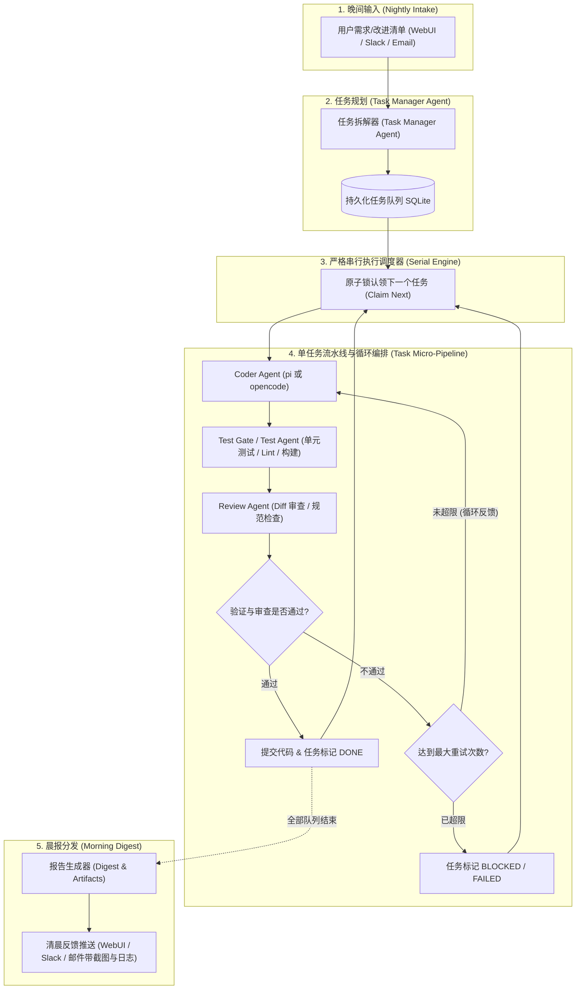

# 夜间串行多 Agent 编排系统 (Night-Shift Orchestrator)
## 项目愿景、需求分析与实施方案

---

## 一、 项目背景与核心理念 (Vision & Philosophy)

### 1.1 硬件现实与使用场景：闲置无头主机夜间值守
* **硬件现实**：现代开发者通常拥有闲置的家庭服务器、Mini PC 或无头（Headless）主机。这些设备算力有限（通常为消费级 CPU、16G-32G 内存、无独立专业 GPU），无法承受多进程重度并发的 LLM Agent 与本地构建环境。
* **时间换空间**：夜间有长达 6-8 小时的充裕低峰期，**串行执行（Strict Serial Execution）**是最佳选择。虽然耗时长，但系统负载极其稳定、不会触发系统 OOM、也不会遭遇 API Rate Limit 剧烈抖动。
* **避免并发烂泥潭**：坚决不依赖复杂的 Git Worktree、多分支并发合并和文件读写锁竞争。每一个任务都在完全干净的单进程环境中从容执行。

### 1.2 "Vibe Coding" 宏观编排 vs 微观控制
* **拒绝做保姆**：传统 Agent UI 频繁向用户索求确认（如 `ask_user`、单步权限批准）。在夜间无人值守场景下，一次等待确认就会导致整晚任务挂死。
* **宏观控制，微观放权**：
  * **不设交互式 `ask_user`**：Worker 必须完全自动决策（`--no-approve` 预信任或 `--auto` 自动授权）。
  * **不给 Worker 擦屁股**：不试图去微观纠正某个 Agent 内部的思考偏误，而是依靠外层的**阶段门禁机制（Gate / Test / Review）**以黑盒视角判定结果。
  * **打回重试而非单步微调**：跑通了就前进，跑崩了直接根据报错重新触发下一轮迭代，超限直接标记挂起。

### 1.3 远期愿景：简易版 "Grok Bot" / 异步开发伙伴
* 每天睡前通过 Slack、邮件或 WebUI 扔给系统一份自由文本形式的《待办/改进清单》。
* 系统唤醒 **Task Manager Agent** 将清单拆解为可落地的结构化任务。
* 编排器驱动底层不同的 CLI Agent（`pi`、`opencode` 等）完成“代码编写 -> 自动化测试 -> 代码评审”流水线。
* 次日清晨，用户醒来收到包含执行摘要、Git Diff、测试日志和界面截图的完整晨报。

---

## 二、 核心业务流程与编排模型 (Workflow & Pipeline)



---

## 三、 对标与吸收：参考 `pi-web` 的经验与革新

`pi-web` (`~/dev/pi-web/docs/tasks.md`) 提供了非常优秀的单机任务系统底座，我们对其精髓予以吸收，并针对多 Agent 与编排循环进行专门拓展：

| 维度 | `pi-web` 原方案 | 本项目设计方案 (Night-Shift) | 改进与取舍理由 |
| :--- | :--- | :--- | :--- |
| **执行模式** | 严格单任务串行 | 严格单任务串行 | 保持一致：保障低配无头机的绝对稳定性与零状态污染 |
| **Agent CLI 支持** | 仅支持 `pi` CLI (RPC 深度绑定) | **可插拔 CLI 适配层** (首发 `pi` + `opencode`) | 突破单一 CLI 局限，针对不同任务类型可灵活选用不同 Agent |
| **交互能力** | 支持 `ask_user`，可在前端弹框等待人类回答 | **彻底关闭交互式等待** (`unattended vibe mode`) | 夜间场景下人类处于睡眠状态，交互式等待会造成整夜死锁 |
| **任务生命周期** | `Coder -> Verify Command` (线性单向) | **支持循环编排的状态机** (`Coder <-> Test <-> Review`) | 真实开发中一次写对概率低，闭环循环修正可大幅提升夜间成功率 |
| **任务录入** | 仅支持前端表单逐条录入或单 session 驱动 | **Task Manager Agent 批量拆解 + Webhook/Slack 接入** | 符合“睡前扔一段大纲，自动拆分多任务”的自然工作流 |
| **技术栈** | Next.js (Node.js) + React + SQLite | **Bun + 轻量 Web 后端 + 原生 SQLite + 现代 WebUI** | Bun 启动毫秒级、单进程内置 SQLite、子进程控制与异步流性能极高 |
| **结果交付** | 前端查看 Session 与结果日志 | **晨报体系 (Morning Digest)**：汇总 Diff、截图、日志 | 提供“晨起阅卷”的自动化管家体验 |

---

## 四、 核心架构设计 (System Architecture)

### 4.1 技术栈选型
* **运行时环境 (Runtime)**: Bun (v1.2+)
  * 原生支持 TypeScript，零配置运行。
  * 内置高性能 `bun:sqlite`（直接支持 WAL 模式，无需繁琐的原生编译绑定）。
  * 内置高吞吐子进程管理 (`Bun.spawn`)，对 Unix 信号传递与流控支持极佳。
* **服务端框架 (Backend)**: Hono (运行于 Bun 原生服务器模式)
  * 极致轻量，路由类型安全，天生支持 Server-Sent Events (SSE) 实时状态流推送。
* **前端 Web UI**: React 19 + Vite + Tailwind CSS + Lucide Icons
  * 专为夜间作业看板优化：暗色模式、任务队列重排、流水线状态视图、终端流输出组件。
* **进程管理与安全**:
  * 采用 POSIX 进程组隔离与 Tree-Kill，确保超时或异常时彻底杀灭子进程及衍生进程，无僵尸进程滞留。

### 4.2 模块拓扑划分

```
┌─────────────────────────────────────────────────────────────┐
│                    Web UI / External Clients                │
│       (Dashboard Kanban / Run Inspector / Slack Webhook)    │
└──────────────┬──────────────────────────────▲───────────────┘
               │ HTTP REST                    │ SSE (Live Events)
┌──────────────▼──────────────────────────────┴───────────────┐
│                    Hono API Server (Bun)                    │
│   /api/tasks  |  /api/queue  |  /api/pipeline  |  /api/ws   │
└──────────────────────────────┬──────────────────────────────┘
                               │
┌──────────────────────────────▼──────────────────────────────┐
│                  Orchestration Core (编排核心)               │
│  ┌───────────────────────┐       ┌────────────────────────┐ │
│  │   Pipeline Engine     │       │    Queue Controller    │ │
│  │ (Coder->Test->Review) │◄─────►│ (Atomic Claim, Settle) │ │
│  └───────────┬───────────┘       └───────────┬────────────┘ │
│              │                               │              │
│  ┌───────────▼───────────┐       ┌───────────▼────────────┐ │
│  │   Agent Adapter Layer │       │    Durable Storage     │ │
│  │ ┌─────────┐ ┌───────┐ │       │   (bun:sqlite WAL)     │ │
│  │ │PiAdapter│ │Open- ││ │       │  tasks, runs, events   │ │
│  │ │         │ │code   │ │       │                        │ │
│  │ └─────────┘ └───────┘ │       │                        │ │
│  └───────────┬───────────┘       └────────────────────────┘ │
└──────────────┼──────────────────────────────────────────────┘
               │ OS Process Spawn (Bun.spawn)
┌──────────────▼──────────────────────────────────────────────┐
│                     Worker CLI Agents                       │
│     pi (RPC/JSON mode)     │     opencode run (--auto)      │
└─────────────────────────────────────────────────────────────┘
```

---

## 五、 关键技术实现要点 (Key Implementations)

### 5.1 多 Agent CLI 兼容层 (Agent Adapter Layer)
不同的 CLI 拥有不同的参数风格与输出格式：
* **`pi` CLI**:
  * 运行模式：`pi --mode json --name "..." --no-approve "prompt"` 或 `pi --mode rpc`
  * 特点：可以通过 JSON 流实时获取 `message`、`tool_use`、`agent_end` 等事件。
* **`opencode` CLI**:
  * 运行模式：`opencode run --format json --auto --title "..." "prompt"`
  * 特点：原生提供 `--auto`（跳过询问并自动授权），具备 `--format json` 输出。

**抽象适配器接口设计 (`AgentAdapter`)**：
```typescript
export interface AgentRunOptions {
  taskId: number;
  runId: number;
  prompt: string;
  cwd: string;
  timeoutMs: number;
  env?: Record<string, string>;
  appendSystemPrompt?: string;
}

export interface AgentEvent {
  type: 'thinking' | 'tool_call' | 'file_change' | 'stdout' | 'stderr' | 'error';
  timestamp: number;
  content: string;
  metadata?: Record<string, unknown>;
}

export interface AgentAdapter {
  readonly id: string; // 'pi' | 'opencode' | 'claude-code' ...
  readonly name: string;
  
  // 检查本地 CLI 是否就绪 (which, version 检查)
  checkReadiness(): Promise<{ ok: boolean; version?: string; error?: string }>;
  
  // 启动并执行
  execute(
    options: AgentRunOptions,
    onEvent: (event: AgentEvent) => void
  ): Promise<{
    exitCode: number;
    summary: string;
    rawTail: string;
  }>;

  // 强制终止
  abort(runId: number): Promise<void>;
}
```

### 5.2 循环流水线状态机 (Looping Pipeline State Machine)
针对每个单项任务，支持小型的闭环重试循环：
1. **Coder Step**：调用选定的 Agent CLI 进行代码开发。
2. **Test Step**：
   - 方式 A：纯 Shell 脚本门禁（如 `bun test`、`npm run lint`）。
   - 方式 B：Test Agent 智能验证（对于复杂 UI 或需要执行端到端检查的场景）。
3. **Review Step**：
   - 收集当前 Git Diff (`git diff HEAD~1` 或 `git status`)。
   - 启动轻量 Review Agent（或使用模型 API 快速评审）。
   - 检查标准：是否满足任务描述、是否存在未处理报错、代码质量与安全性。
4. **决策判定与循环机制**：
   - 如果 Test 失败或 Review 给出 `REJECT`：
     - 若当前重试轮次 `< maxRetries`（默认 3 次）：
       - 将 **报错日志 + Review 反馈** 拼装为新的 Prompt，重新投喂给 Coder Agent。
     - 若重试超限：
       - 标记任务为 `FAILED` 或 `BLOCKED`，记录现场状态并保存，继续下一任务（或暂停队列）。
   - 如果通过：
     - 自动进行规范的 Git Commit（如 `git commit -m "feat(task-12): ..."`）。
     - 标记任务为 `DONE`。

### 5.3 数据持久化模型 (SQLite Schema)
借鉴 `pi-web` 的高可靠原子设计，增加对流水线阶段与循环重试的记录：

```sql
-- 任务定义表
CREATE TABLE tasks (
  id               INTEGER PRIMARY KEY AUTOINCREMENT,
  batch_id         TEXT,                 -- 所属批次（例如: 2026-11-03-nightly）
  title            TEXT NOT NULL,
  description      TEXT NOT NULL,
  assigned_agent   TEXT NOT NULL DEFAULT 'pi', -- 'pi' | 'opencode'
  status           TEXT NOT NULL DEFAULT 'PENDING'
                     CHECK (status IN ('PENDING','IN_PROGRESS','DONE','BLOCKED','FAILED')),
  rank             INTEGER NOT NULL,     -- 串行排序权重 (10, 20, 30...)
  cwd              TEXT NOT NULL,        -- 项目根目录
  verify_commands  TEXT,                 -- JSON 数组: ['bun test', 'bun run build']
  max_retries      INTEGER NOT NULL DEFAULT 3,
  current_retry    INTEGER NOT NULL DEFAULT 0,
  pipeline_stage   TEXT,                 -- 'CODER' | 'TEST' | 'REVIEW' | 'IDLE'
  result_summary   TEXT,
  created_at       TEXT NOT NULL,
  updated_at       TEXT NOT NULL,
  finished_at      TEXT
);

-- 单次尝试记录表 (包含循环历史)
CREATE TABLE task_runs (
  id             INTEGER PRIMARY KEY AUTOINCREMENT,
  task_id        INTEGER NOT NULL REFERENCES tasks(id) ON DELETE CASCADE,
  attempt        INTEGER NOT NULL,
  stage          TEXT NOT NULL,          -- 'CODER' | 'TEST' | 'REVIEW'
  agent_id       TEXT NOT NULL,
  status         TEXT NOT NULL,          -- 'SUCCESS' | 'FAILED' | 'REJECTED'
  feedback       TEXT,                   -- 给下一次迭代的纠错反馈信息
  output_tail    TEXT,                   -- 运行日志截断
  started_at     TEXT NOT NULL,
  finished_at    TEXT
);

-- 队列全局状态表 (单行保护)
CREATE TABLE queue_state (
  id              INTEGER PRIMARY KEY CHECK (id = 1),
  state           TEXT NOT NULL,         -- 'IDLE' | 'RUNNING' | 'PAUSED'
  paused_reason   TEXT,
  active_task_id  INTEGER,
  active_stage    TEXT,
  updated_at      TEXT NOT NULL
);
```

---

## 六、 实施方案与里程碑规划 (Implementation Roadmap)

### Phase 1：核心骨架与持久化队列 (Core Engine & Storage)
* 初始化 Bun 基础工程结构，配置 TypeScript、代码规范与测试环境。
* 实现 `bun:sqlite` 数据访问层与 WAL 配置，建立 `tasks`、`task_runs`、`queue_state` 表结构。
* 编写 `QueueController`：实现事务级 `claimNext`、`settle`、`reorder`、`retry` 及服务重启自愈逻辑。
* 编写单测确保原子锁与无状态泄漏。

### Phase 2：多 Agent CLI 适配层 (Pluggable Adapters)
* 定义 `AgentAdapter` 规范。
* 实现 `PiAdapter`：封装 `pi` CLI，处理 `--mode json/rpc`、无交互参数 `--no-approve`、日志流截断与优雅中断。
* 实现 `OpenCodeAdapter`：封装 `opencode run`，支持 `--auto`、`--format json`。
* 适配层集成测试：在临时沙箱目录测试两种 CLI 的调起、标准输出收集、异常拦截和超时中止。

### Phase 3：串行循环编排引擎 (Looping Pipeline Orchestrator)
* 编写 `PipelineRunner`：实现 `Coder -> Test Gate -> Review Gate` 的流水线执行。
* 实现打回机制：当 Test 或 Review 报错时，提取反馈组装成二次修复 Prompt，触发受控循环（最多 N 次）。
* 编写看门狗（Watchdog）：单个阶段超时强制退出并杀灭进程树。
* 自动 Git Commit 机制：任务成功时自动格式化提交。

### Phase 4：Task Manager Agent 任务规划与批量分解
* 实现针对自然语言需求清单的 Task Manager Agent 模块。
* 能够将睡前文本（Markdown/Todo 列表）自动化拆分成结构化任务项并入库。
* 提供 CLI 预检与参数默认继承机制（CWD、测试命令等）。

### Phase 5：Bun WebUI 控制面板与实时观测 (Dashboard & Visualizer)
* 基于 Hono 提供 RESTful API 与 SSE 实时事件流通道。
* 搭建现代 WebUI：
  * 任务队列看板：拖拽/按钮排序、状态徽标、耗时统计。
  * 实时流水线跟踪：显示当前正在跑哪个任务、处于哪一阶段（Coder/Test/Review）、当前循环次数。
  * 实时输出控制台：展示 Worker 的终端日志与思考流。
  * 任务手动启停、单项重试与跳过。

### Phase 6：晨报系统与异步生态接入 (Grok Bot 演进)
* 实现夜间批次结束后的 **Morning Digest** 生成器（汇总任务完成数、Git Diff 统计、测试报告、报错归纳）。
* 支持产物收集：截图（若有 Playwright 测试）与日志附件。
* 对接外部通知管道：Slack Webhook / 邮件发送器。
